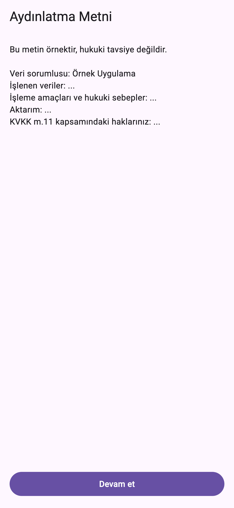
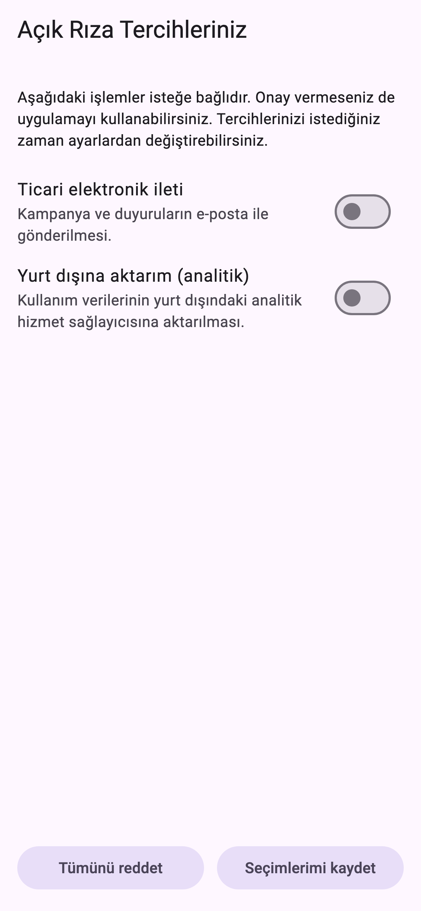

# kvkk_consent

[](https://github.com/gokturkp0/kvkk_consent/actions/workflows/ci.yml)
[](LICENSE)

[Türkçe](README.md) · **English**

<p>
  
  &nbsp;
  
</p>

A small, dependency-free **privacy notice + explicit consent** flow for Flutter
apps that process personal data under **KVKK**, Turkey's Personal Data
Protection Law (Law No. 6698).

- The privacy notice (*aydınlatma metni*) and explicit consent (*açık rıza*)
  are shown on **separate screens**.
- Every processing purpose has its own switch, and all switches start **off**.
- "Reject all" and "Save" have equal visual weight, and users who refuse can
  still use the app.
- Every decision is stored **append-only** with the text version and a
  timestamp; when a text version changes, the user is asked again.
- The full history can be exported as JSON.

The default UI labels are Turkish; English labels ship too
(`KvkkStrings.en`).

> ⚠️ This package is **infrastructure** for compliance, not legal advice and not
> a compliance guarantee. Write your privacy notice and consent purposes based
> on your own data processing.

## Why this package?

Under KVKK, informing users and obtaining explicit consent are two different
things: the user is informed first, while explicit consent is defined as
consent on a specific matter, based on information and given with free will.
That means consent has to be asked per purpose, and refusing has to be
possible. Many apps still squeeze this into a single "I have read and accept"
checkbox; this package gives you a ready-made flow that keeps the two steps
apart.

## Installation

```yaml
dependencies:
  kvkk_consent: ^0.1.0
```

or:

```bash
flutter pub add kvkk_consent
```

### Development version

```yaml
dependencies:
  kvkk_consent:
    git: https://github.com/gokturkp0/kvkk_consent.git
```

## Usage

```dart
final kvkk = KvkkConsentController(
  config: KvkkConfig(
    noticeText: privacyNoticeText,
    noticeVersion: '2026-11-18',
    consentVersion: '2026-11-18',
    purposes: const [
      ConsentPurpose(
        id: 'marketing',
        title: 'Commercial electronic messages',
        description: 'Sending campaigns by e-mail.',
      ),
    ],
  ),
  store: JsonStringConsentStore(
    read: () async => prefs.getString('kvkk'),
    write: (v) => prefs.setString('kvkk', v),
  ),
);
await kvkk.load();

runApp(MaterialApp(
  home: KvkkGate(
    controller: kvkk,
    strings: KvkkStrings.en,
    child: const HomePage(),
  ),
));

// Before sending a campaign e-mail:
if (kvkk.isGranted('marketing')) { /* ... */ }
```

To let users change their choices later, open `KvkkConsentPage` from your
settings screen.

Working example: [`example/lib/main.dart`](example/lib/main.dart).

## FAQ

**Can I use it for GDPR?**
The package is designed for KVKK. Its structure (separate notice, per-purpose
consent that defaults to off, an audit history) can be a starting point for
other regulations, but there is no GDPR-specific mode or ready-made text, and
assessing compliance is up to you.

**How do I send consent records to my server?**
The package never sends any data by itself. Either implement your own
`ConsentStore` and send the records in `save`, or send the output of
`kvkk.exportJson()` yourself.

**What happens when I change the privacy notice?**
Bump `noticeVersion` (or `consentVersion` for the consent texts). Records made
for the old version no longer count and the user is asked again; the old
records stay in the history.

## Used by

Nobody yet.

If you use this package, add your app to this list with a PR.

## Development

```bash
./tool/check.sh   # format + analyze + test
```

See [`CONTRIBUTING.md`](CONTRIBUTING.md) for the contribution process (in
Turkish, with an English summary at the top). AI coding agents read
[`AGENTS.md`](AGENTS.md) first; it lists the package's invariants and a file
map.

## License

Released under the [MIT License](LICENSE). You can use it freely in your own
projects, including commercial and closed-source apps; the only condition is
keeping the license text with its copyright notice.
