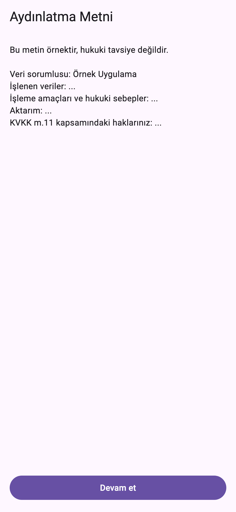
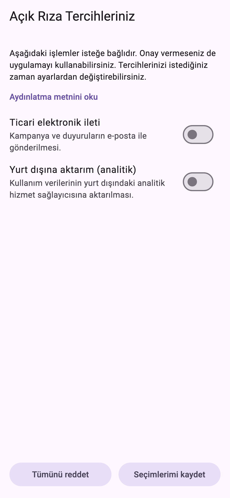

# kvkk_consent

[](https://github.com/gokturkp0/kvkk_consent/actions/workflows/ci.yml)
[](LICENSE)

**Türkçe** · [English](README.en.md)

> **In English:** A dependency-free Flutter flow that shows the KVKK (Turkish
> data protection law) privacy notice and per-purpose explicit consent on
> separate screens, and keeps a versioned, append-only consent history.
> Full English documentation: [README.en.md](README.en.md).

<p>
  
  &nbsp;
  
</p>

Flutter uygulamaları için küçük, bağımlılıksız bir **KVKK aydınlatma + açık
rıza** akışı.

- Aydınlatma metni ile açık rıza **ayrı ekranlarda** gösterilir.
- Her işleme amacı için ayrı anahtar vardır; hepsi **kapalı** başlar.
- "Tümünü reddet" ile "Kaydet" eşit ağırlıktadır; reddeden kullanıcı da
  uygulamayı kullanır.
- Her karar metin sürümü ve zamanıyla **eklemeli** olarak kaydedilir; metin
  sürümü değişince kullanıcıya yeniden sorulur.
- Geçmiş JSON olarak dışa aktarılabilir.

> ⚠️ Bu paket uyum için bir **altyapıdır**, hukuki tavsiye ya da uyum garantisi
> değildir. Aydınlatma metninizi ve rıza amaçlarınızı kendi veri işleme
> faaliyetlerinize göre hazırlayın.

## Neden bu paket?

KVKK'da aydınlatma ile açık rıza ayrı şeylerdir: kullanıcı önce
bilgilendirilir, açık rıza ise belirli bir konuya ilişkin, bilgilendirmeye
dayanan ve özgür iradeyle açıklanan bir onaydır. Bu yüzden rıza her amaç için
ayrı alınmalı ve reddetmek mümkün olmalıdır. Buna rağmen pek çok uygulama
bunu tek bir "Okudum, kabul ediyorum" kutusuyla geçiştirir; bu paket iki
adımı ayrı tutan hazır bir akış sunar.

## Kurulum

```yaml
dependencies:
  kvkk_consent: ^0.1.0
```

ya da:

```bash
flutter pub add kvkk_consent
```

### Geliştirme sürümü için

```yaml
dependencies:
  kvkk_consent:
    git: https://github.com/gokturkp0/kvkk_consent.git
```

## Kullanım

```dart
final kvkk = KvkkConsentController(
  config: KvkkConfig(
    noticeText: aydinlatmaMetni,
    noticeVersion: '2026-11-18',
    consentVersion: '2026-11-18',
    purposes: const [
      ConsentPurpose(
        id: 'marketing',
        title: 'Ticari elektronik ileti',
        description: 'Kampanyaların e-posta ile gönderilmesi.',
      ),
    ],
  ),
  store: JsonStringConsentStore(
    read: () async => prefs.getString('kvkk'),
    write: (v) => prefs.setString('kvkk', v),
  ),
);
await kvkk.load();

runApp(MaterialApp(
  home: KvkkGate(controller: kvkk, child: const HomePage()),
));

// Kampanya e-postası göndermeden önce:
if (kvkk.isGranted('marketing')) { /* ... */ }
```

Tercihleri sonradan değiştirmek için ayarlardan `KvkkConsentPage` açın.
Rıza ekranındaki "Aydınlatma metnini oku" bağlantısı, kullanıcının karar
verirken aydınlatma metnine yeniden bakabilmesini sağlar.

**Dil:** `strings` verilmezse arayüz dili cihaz diline göre seçilir: Türkçe
cihazda Türkçe, diğerlerinde İngilizce. Dili sabitlemek ya da uygulamanızın
kendi dil ayarını kullanmak için `strings: KvkkStrings.tr` (veya `.en`) verin.

**Kayıt sırasında:** düğmeler devre dışı kalır, bu yüzden çift dokunma çift
kayıt oluşturmaz. `ConsentStore` hata verirse kullanıcıya kısa bir uyarı
gösterilir, hiçbir şey kaydedilmez ve hata `FlutterError.reportError` ile
loglarınıza düşer.

Çalışan örnek: [`example/lib/main.dart`](example/lib/main.dart).

## SSS

**GDPR için kullanılabilir mi?**
Paket KVKK için tasarlandı. Akışın yapısı (ayrı bilgilendirme, amaç bazlı ve
varsayılanı kapalı rıza, kayıt geçmişi) başka düzenlemeler için de başlangıç
olabilir; ancak GDPR'ye özgü bir mod ya da hazır metin yoktur ve uyum
değerlendirmesi size aittir.

**Rıza kayıtlarını sunucuya nasıl gönderirim?**
Paket hiçbir veriyi kendisi göndermez. İki yol var: kendi `ConsentStore`
uygulamanızı yazıp `save` içinde sunucunuza gönderin ya da
`kvkk.exportJson()` çıktısını kendiniz iletin.

**Aydınlatma metnini değiştirince ne olur?**
`noticeVersion` (rıza metinleri için `consentVersion`) değerini artırın.
Eski sürüme ait kayıtlar geçerli sayılmaz ve kullanıcıya yeniden sorulur;
eski kayıtlar geçmişte kalır.

## Kullananlar

Henüz kimse eklenmedi.

Paketi kullanıyorsanız bu listeye PR ile ekleyin.

## Geliştirme

```bash
./tool/check.sh   # format + analyze + test
```

Katkı süreci için [`CONTRIBUTING.md`](CONTRIBUTING.md) dosyasına bakın.

Bu depoda yapay zekâ kodlama ajanlarıyla çalışıyorsanız ajanlar önce
[`AGENTS.md`](AGENTS.md) dosyasını okur. Bu dosya paketin değişmez kurallarını
ve dosya haritasını içerir.

## Lisans

[MIT Lisansı](LICENSE) ile dağıtılır. Kendi projelerinizde, ticari ve kapalı
kaynak uygulamalar dahil, özgürce kullanabilirsiniz; tek koşul lisans
metnini (telif bildirimiyle birlikte) korumaktır.
